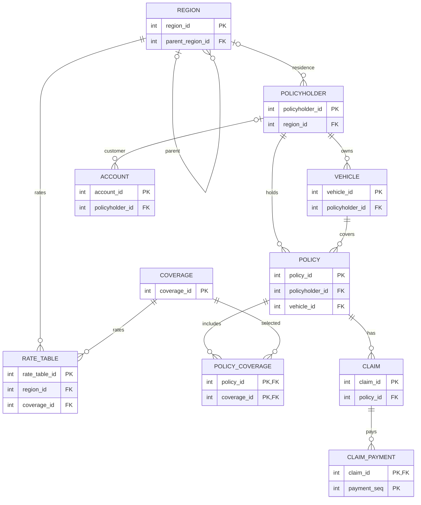

# AutoRisk import ERD

This diagram replaces the data team's export ERD. It follows the relationships in the team snapshot's `autorisk-app/db/schema.sql`.

The loader uses the seeded Liability coverage and leaves team accounts in place. All imported policies have one holder, vehicle, and Liability coverage row. The export uses a negative source ID for each holder, vehicle, and policy, with the positive ID retained in the analytics CSV.
